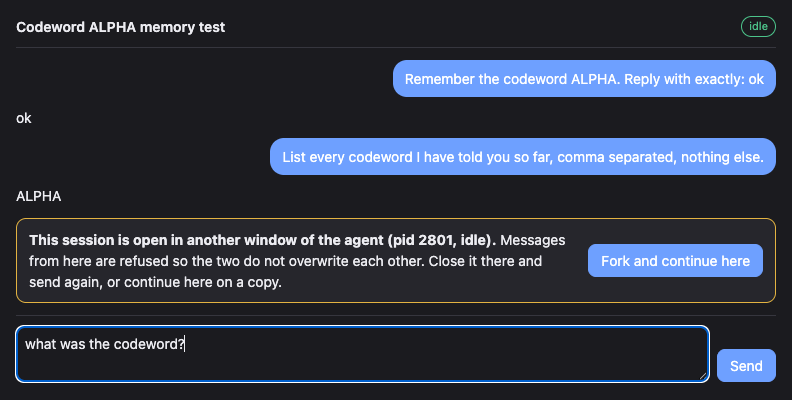
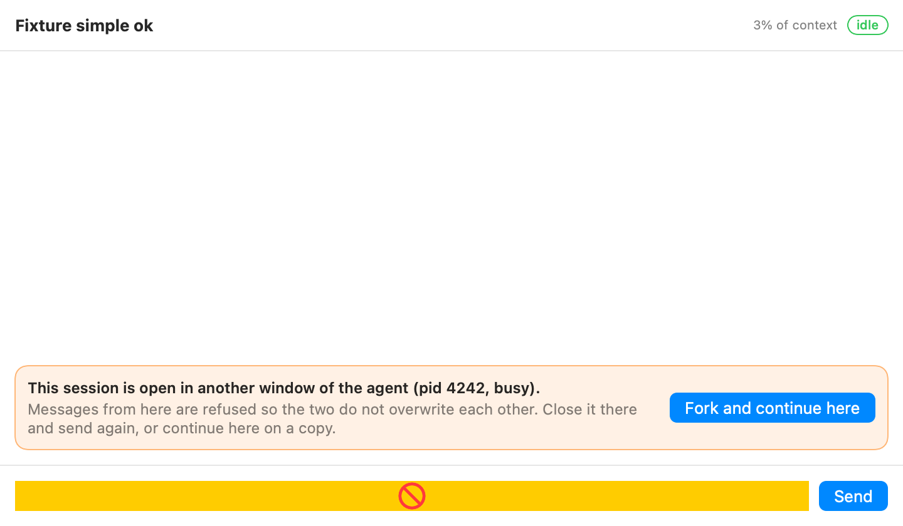

# One session, two Claude processes

_2026-11-22. Probe: `docs/research/spikes/acp-probe/twoproc.mjs` (three short Haiku turns), plus a read of Claude Code's files on disk. Claude Code 2.1.330._

## The question

The daemon holds a session in one harness process. Nothing stops the user from resuming the same session in Claude's own terminal or the VS Code extension. What happens then, and what does Claude Code itself do about it?

## What Claude Code does

**It does not block.** A second process resumed a session the first still held, and was accepted.

**Each process has its own memory.** Process A was told ALPHA. Process B resumed the session and was told BRAVO. Asked afterwards for every codeword, A answered `ALPHA`. It never saw B's turn.

**The transcript forks instead of breaking.** Messages in the transcript file point at the message before them. After the probe, one message had two follow-ups: A's next turn and B's turn. The file stays valid; it holds two branches.

**A later reader gets one branch.** A third process that replayed the session got A's branch (the last one written). B's turn is in the file and shown to nobody.

**It keeps a registry of running processes.** Each Claude Code process writes `~/.claude/sessions/<pid>.json` with its pid, the session id, the working directory, how it was started, and whether it is `busy` or `idle`. Processes started by the ACP adapter are listed too. During the probe the same session id appeared under two pids.

So the answer to "how did they solve it" is: they did not prevent it. They made it harmless to the file, and they record who has what open.

## What this gives the daemon

For Claude, the registry answers the question the daemon could not answer before: is this session open in another process right now, and is that process in the middle of a turn?

- Before adopting a session, or sending a prompt to one, the daemon can look for another live process with that session id.
- "Live" can be checked: the file has the pid and the process's start time.

Limits:

- The registry is Claude Code's own file layout, not a documented interface. It can change with any release, so the daemon must treat a missing or unreadable registry as "unknown", not as "free".
- It is a check, not a lock. Two processes can still start at the same moment.
- Pi was not probed. Whether it has anything similar is unknown.

## What was built from this (2026-11-22)

Decision from the user: block by default, offer to fork.

- **Block.** A request that acts on a session (a prompt, a setting) is refused with error `-32004` when another process of the harness has the session open. The error says which process and whether it is busy. The check comes before anything is loaded, so a refused request starts nothing. `whenOpenElsewhere: "allow"` in `config.json` turns the block off.
- **Reading stays allowed.** Attaching loads the history through the adapter. In the live check that wrote nothing to the transcript.
- **The list says so.** `openElsewhere` on each session; `!` in `archipel sessions`.
- **Fork.** ACP's `session/fork`: the harness makes a new session with the same history, which only the daemon has open. The daemon records it and loads its history like an adopted session. `archipel fork SESSION`, `forkSession()` in TypeScript, `fork()` in Swift. The original is untouched.

Probe of fork on the Claude adapter (`docs/research/spikes/acp-probe/fork.mjs`, no model call): it works on a session the adapter process never opened, returns a new id, and the copy is titled "… (fork)".

Live check, with no model call: the daemon listed 116 sessions and marked two as open elsewhere, this conversation's among them. A prompt for it was refused: "open in another process of the agent (pid 60406, busy)". A fork of a small session was created and read back with its history.

Where the check comes from: each agent's profile may say who else has a session open. Claude's reads Claude Code's registry and ignores the processes the daemon's own adapter started. Pi's says nothing yet, so Pi sessions are never blocked; Pi was not probed, and its adapter has no fork.

Still not covered: a second process that starts in the moment between the check and the prompt, and any harness without a registry.

## The fork button in the chat views (2026-11-23)

Asked by the user: "add the fork button to the React and SwiftUI chat views".

What a chat shows when another process has its session open: a notice above the composer that says so and names the process, with a button "Fork and continue here". The button makes the copy and the app shows it in place of the original.

(The SwiftUI picture is drawn off screen, where the scroll area and the text field do not render.)

Choices made:

- **The chat knows before the user types.** The answer to `_archipel/session/attach` now carries `openElsewhere` (who has it), so the notice is there when the session opens. The SDK's session keeps it as `openElsewhere`, and updates it after every prompt: a refusal sets it, a prompt that goes through clears it.
- **The composer stays usable.** The daemon does not announce when the other process closes the session, so a disabled composer could stay disabled for no reason. Instead the user may send again: if the other process is gone it works and the notice goes away.
- **A refused message is not lost.** It goes back into the field, unless the user has typed something else since. Other refusals (for example a read-only connection) are now shown under the composer; before, they were dropped.
- **The button is only drawn when the app can show the copy.** The app passes `onFork` (React: `useSession(session, { onFork })`; SwiftUI: `LiveChatView(session:onFork:)`) and receives the new session. Without it the notice only explains.
- **A fork that fails says why** in the notice (Pi's adapter, for example, has no fork).

Checked live in a headless browser against the real daemon and the Claude adapter, with no model call: the notice appeared on opening the session, a message was refused and came back into the field, and the button replaced the chat with "Codeword ALPHA memory test (fork)" and its history. The "other process" in this check was a stand-in: an entry in a scratch copy of Claude Code's registry that pointed at a sleeping process. A real second Claude terminal was tried first and stopped at Claude Code's "do you trust this folder?" question, which was not answered. The SwiftUI view was drawn by its test and built into the demo app; nobody clicked it.
